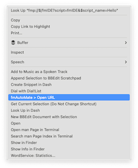

> Migrated from the existing fmIDE wiki. This page preserves background and historical examples; version-sensitive integration details have not all been re-tested. Use the current [action reference](../actions/README.md), [parameter reference](../parameters/README.md) and [setup guide](../installation.md) for active work.


**[A FileMaker Integrated Development Environment]**


[fmIDE](../README.md) is a FileMaker module to make integration of your FileMaker database into your development processes and analysis tools easier and tighter!

---

# Installing fmIDE

fmIDE needs to be installed into each FileMaker file you want to magically access, but since it needs to be tweaked to your 
layout naming conventions it pays to first install it to one file of your solution and tweak it before copying it to all files of your solution.

1. Check the [System Requirements](#system-requirements)
2. Download
   - Download the [latest version of fmIDE](https://github.com/fmIDE/fmIDE/releases)
   - and open the fmIDE.fmp12 demo file in FileMaker
3. Copy & Paste
   - Open the Script Workspace
   - Copy the `fmIDE Module` folder 
   - Paste the folder into the Script Workspace of your chosen solution file.

That's enough to use 80% of fmIDE functionality! Try this from another file:

```
Perform Script [ from List “fmIDE“ from file ”YourFile” ; JSONSetElement( "" ; "script_name" ; "YourScript" ; JSONString)]
```

```
Perform Script [ “fmIDE“ from file ”YourFile” ; JSONSetElement( "" ; "layout_name" ; "YourScript" ; JSONString)]
```

4. Permit fmpurls
   - fmIDE uses fmpurls to let your developer environment speak to your FileMaker files
   - In the file's security grant permission to run scripts via fmp url to your `[FullAccess]` privelege set
     - Open `Security > Advanced > Extended Privileges` 
     - choose the `fmurlscript` extended privilege
     - check the [FullAccess] privilige set
     - Select [X] On for the [Full Access] Privilege Set
   - Note: If you are not happy with activating fmp urls, that's ok. It is also possible to use fmIDE with simple script calls … *just not so much fun!* 

5. Prime:
   - If your database's P.T.O.-names, base-table-names and base-layout-names differ from each other
   - You'll need to prime the database by [customising the fmIDE Interface Callback Scripts](#customising-fmide)

# Installing the fmIDE > Retype Keyboard Buffer Service

fmIDE uses an automater service (typically triggered by the F12 key) to retype the name of the entry you are looking for in a list dialog.

1. Install the service:
   - Double click the `fmIDE > Retype Keyboard Buffer.workflow` file.
   - Choose `Install` to install the Quick Action / Service.
2. Setup the keyboard shortcut:
   - Open System Settings from the Apple Menu.
   - Choose `Keyboard`
   - Swap to the `Shortcuts` tab
   - Select `Services`
   - Scroll down until you find the `fmIDE > Retype Keyboard Buffer` service.
   - Click `Add Shortcut`and press `F12` (or whichever key you'd like to use)

# Customising fmIDE

fmIDE gets to the (base-)table you desire, by first going to the equivalent `base-layout`. This assures that the Database Dialog opens in the correct table.

To make this work, you need to 

1. have/create one `base-layout` for each `base-table` in the database file
2. if necessary, customise the fmIDE Callback API script(s) to match base layout to base table 
   - Note:
     - Do this step, only if your base layouts are named differently to your PTOs (primary table occurrences)
     - If there is an identically named layout for each table in your solution, you can skip this section entirely
   - Copy & Paste the fmIDE Callback API script folder to your first file
   - Edit the scripts, so they return the data for your DB
   - Change the `fmIDE.GetBaseLayoutName` script to return the correct `layout_name`.
     - This is usually just a case of setting the `$layout_name_prefix` to match the prefix you use
  - The `fmIDE.GetBaseLayoutName` script is currently not used
     - however, **watch this space**
3. Copy & Paste the now customised fmIDE Callback API script folder to each file


# Saying Hello to fmIDE

Once you have the fmIDE file open in FileMaker, try opening these urls[^1]:

[Run the `Hello` script](fmp://$/fmIDE?script=Hello) in the fmIDE demo file:

    fmp://$/fmIDE?script=Hello

=> If that worked, your fmp-url permissions are ok!

[Edit the `Hello` script](fmp://$/fmIDE?script=fmIDE&$script_name=Hello) using the `fmIDE 'name that thing' API`:

    fmp://$/fmIDE?script=fmIDE&$script_name=Hello

=> and, if that worked, congratulations, you are at the start of a very exciting journey!

# System Requirements

This section is under construction!

- Operating System
  - fmIDE has been made on a Mac
  - It is planned to work on Windows (at least in part), but has not yet been tested (please help!)

- FileMaker Version
  - fmIDE has been made in fm19 and uses While
  - Lower limit needs to be tested

- Plugins
  - fmIDE uses MBS Plugin profusely.
  - Need to test (& document) if anything works at all with no MBS Plugin, and if yes, then what.


---

[^1]:Note: fmp-urls are sadly not supported in (freemium) GitHub.

To open the url…

- If you have `fmAutoMate` and have installed `fmAutoMate Services`
    1. Select the url
    2. Right click
    3. Select `fmAutoMate > Open URL`

    
- otherwise copy+paste the urls to your browser's address line
- Maybe later, we can upgrade, or get a project started to create a Chrome extension to add links to fmp urls?
