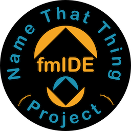
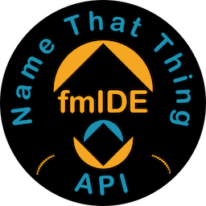

> Migrated from the existing fmIDE wiki. This page preserves background and historical examples; version-sensitive integration details have not all been re-tested. Use the current [action reference](../actions/README.md), [parameter reference](../parameters/README.md) and [setup guide](../installation.md) for active work.



The [fmIDE 'Name that thing' Project](name-that-thing-project.md) aims to 

- promote fmIDE Integration in as many FileMaker tools as possible
- esatblish fmIDE as a global tool.

# Calling all FileMaker toolmakers!

I presented a new tool on Sat. 8th October 2022 at the [fmguru FileMaker Week Conference](https://www.mettilealialtuosviluppofilemaker.com/en/) in Rome - and this tool is really for you guys!

I have a question:

> 💬 **Wouldn't it be great if your users could jump to the exact object they are looking at in your tool with just one keypress / click?**


Yeah?

Then let me introduce fmIDE:

## fmIDE


[A FileMaker Integrated Development Environment]


fmIDE is basically a one-script module - the `fmIDE` script - that FileMaker developers can slap into their files to extend the FileMaker Development Environment with some really cool functionality.

The most important feature here is the [fmIDE 'Name that Thing' API](../name-that-thing.md):

## fmIDE 'Name that Thing' API




This is a *really simple API* for jumping straight to …er… *that thing* - script, account, custom function, *whatever* - in FileMaker. 

It is best called via an fmp url that simply passes variables to the `fmIDE` script, naming the thing the user wants to see.


For example:

- This fmp url goes to layout "I Example" in the (open) fmGuruDemo file:

   ```
   fmp19://$/fmGuruDemo?script=fmIDE&$layout_name=I%20Example
   ```

- This fmp url goes to script step 2 of script "Hello" in the (open) fmGuruDemo file 

   ```
   fmp19://$/fmGuruDemo?script=fmIDE&$script_name=Hello&$script_step_number=2
   ```
- And if you know the file is located on a particular server, you can also specify the server url to automatically open the file:

   ```
   fmp19://192.168.1.4/fmGuruDemo?script=fmIDE&$script_name=Hello&$script_step_number=2
   ```


## So, what do tool developers have to do?

In short:

1. Write one script `fmIDE: Go to Thing`
2. Create a Custom Menu Item
    - Name: "Go to Thing in fmIDE"
    - Performs Script "fmIDE: Go to Thing"
    - Keyboard shortcut = ⇧⌘M

That's it!

And since I have made an example script for Cross Check & BaseElements - the ground work is done for you, so you  

See [`fmIDE-Go to Thing` Script](go-to-thing.md)
